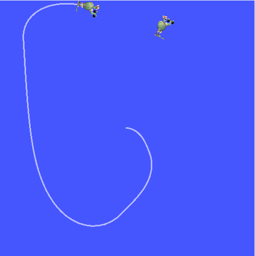
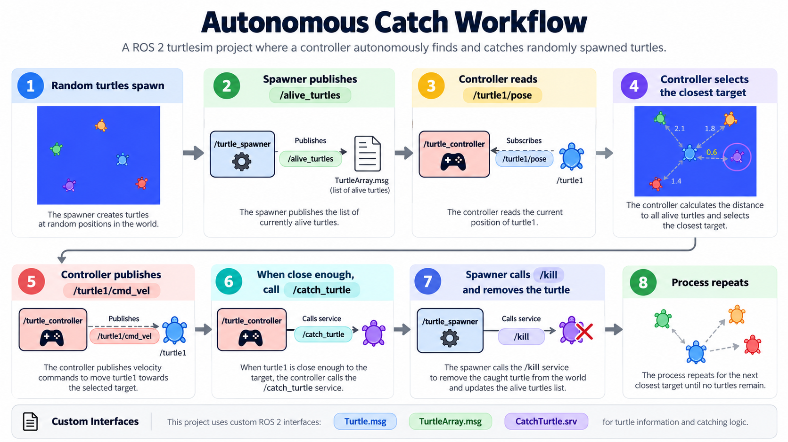
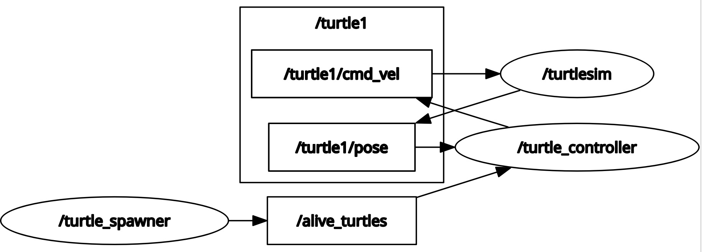

# ROS 2 Turtlesim Catch Them All

A beginner ROS 2 project that demonstrates autonomous target selection, proportional motion control, custom ROS 2 interfaces, publishers/subscribers, services, timers, and multi-node communication using Turtlesim.

The master turtle (`turtle1`) automatically detects spawned turtles, selects the closest target, navigates toward it, catches it, and then continues toward the next available turtle.

---
## Project Demo



## Autonomous Catch Workflow



## System Architecture


## ROS 2 Communication Graph



## Demo Behavior

The application performs the following sequence:

1. Random turtles are spawned inside the Turtlesim environment.
2. The spawner keeps track of all currently alive turtles.
3. The alive turtle list is published on `/alive_turtles`.
4. The controller calculates the distance from `turtle1` to every available turtle.
5. The closest turtle is selected as the current target.
6. A proportional controller drives `turtle1` toward the target.
7. When the target is reached, the controller calls the `/catch_turtle` service.
8. The spawner calls the Turtlesim `/kill` service.
9. The caught turtle is removed from the alive turtle list.
10. The controller selects the next closest turtle.

---

## Features

- Random turtle spawning
- Autonomous turtle navigation
- Closest-target selection
- Proportional linear and angular control
- Alive turtle tracking
- Custom ROS 2 messages
- Custom ROS 2 service
- Publishers and subscribers
- ROS 2 service clients and servers
- Asynchronous service calls
- Timer-based control loop
- Automatic target removal
- XML launch file

---

## Project Structure

```text
ros2_turtlesim_catch_them_all/
├── README.md
├── .gitignore
└── src/
    ├── custom_interfaces/
    │   ├── msg/
    │   │   ├── Turtle.msg
    │   │   └── TurtleArray.msg
    │   └── srv/
    │       └── CatchTurtle.srv
    │
    ├── turtlesim_catch_them_all/
    │   └── turtlesim_catch_them_all/
    │       ├── turtle_spawner.py
    │       └── turtle_controller.py
    │
    └── turtlesim_catch_them_all_bringup/
        └── launch/
            └── turtlesim_catch_them_all.launch.xml
